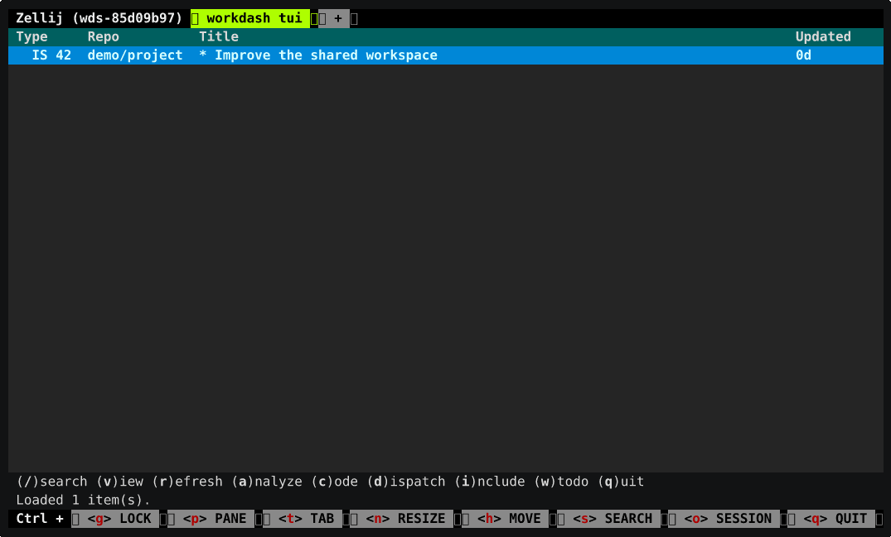

# workdash

Text-based GitHub work triage dashboard ( <https://alessandro.molina.fyi/workdash/> )

`workdash` pulls together the issues and pull requests that matter to you across
your GitHub repositories, suggests what to pick up next, and makes it easy to
jump into a work item — for a quick review, a deeper AI-assisted analysis, or a
full coding session in a dedicated worktree.



Linux and macOS (not tested on Windows). Requires Python `>=3.12`, an
authenticated [`gh`](https://cli.github.com/), `zellij`, a viewer command for
opening links, and at least one agent CLI tool (for example `claude`, `codex`,
`pi`, or `vibe`).

## Installing workdash

With [`uv`](https://docs.astral.sh/uv/):

```bash
uv tool install workdash
```

On the first run, `workdash` starts an interactive setup wizard that asks for:

- your GitHub username,
- the repositories to track (`owner/*` by default),
- the todo repository and the working directory for per-item worktrees,
- the agents to use (found on your `PATH` are added automatically).

If `gh` or `zellij` are not on your `PATH`, the wizard downloads local copies;
run `gh auth login` if `gh` is not authenticated. Re-run the wizard at any time
with `workdash --configure`.

## Using workdash

```bash
workdash
```

launches the dashboard in a persistent Zellij session (use `--session NAME` for
another one). Each row is an issue or pull request; one row is marked `*` as
the suggested next pick. Keys:

| Key | Action |
| --- | --- |
| `/` | Filter the list by type, repo, or title (e.g. `IS 42`); press again to clear. |
| `v` | View menu for the selected item: `v` reads it as Markdown in a pane, `o` opens its GitHub URL in your viewer. |
| `r` | Refresh the list from GitHub. |
| `a` | Analyze the selected item with a configured agent; the result opens in the analysis viewer (cached while the item is unchanged). |
| `c` | Code menu: launch a coding agent in the item's dedicated worktree, or choose VSCode, a branch diff, a terminal, or an autonomous review. |
| `d` | Start an autodispatch session on the selected issue: the agent implements it, reviews the resulting PR, and loops until done. |
| `m` | Toggle automerge for a running autodispatch session. |
| `w` | Capture a todo (created as an issue in your todo repository). |
| `q` | Quit the dashboard; the session and its panes keep running. |

## Workdash CLI

The CLI talks to the running dashboard: `workdash` starts the TUI and a JSON
control API in the same process (default `127.0.0.1:8765`, override with
`WORKDASH_HOST` or `--host HOST[:PORT]`), and the commands below call it.

| Command | Purpose |
| --- | --- |
| `workdash list [--refresh] [--json]` | Print the dashboard items, optionally refreshed from GitHub first. |
| `workdash ready SCOPE [--json]` | List the GitHub work ready to be picked up next. |
| `workdash dispatch SCOPE [--agent NAME] [--group NAME]` | Launch one ready issue with a coding agent. |
| `workdash autodispatch SCOPE [--agent NAME] [--group NAME]` | Start a supervised session that keeps dispatching ready work. |
| `workdash autodispatch-stop SESSION_ID` | Stop a running session. |
| `workdash analyze ITEM [--agent NAME]` | Analyze an item; result is cached and viewable. |
| `workdash review ITEM [--agent NAME]` | Start an autonomous review of an open PR. |
| `workdash code ITEM [--agent NAME] [--autostart] [--autoclose]` | Launch a coding agent in the item's worktree. |
| `workdash terminal ITEM` | Open a shell in the item's worktree. |
| `workdash todo TEXT [--target REPO] [--body BODY]` | Capture a todo; `workdash todo --close ITEM` closes one. |
| `workdash info [--all] [--json]` | Report live Workdash-owned Zellij panes and sessions. |
| `workdash birdview [--top N] [--format telegram\|markdown\|json]` | Shareable snapshot of ongoing work. |
| `workdash read PANE_ID [--full]` / `workdash write PANE_ID TEXT` | Read text from / send text to a live pane. |
| `workdash show-config [--json]` | Show the effective configuration. |
| `workdash view TARGET` | Read a document — a GitHub item, local file, or URL — in the built-in viewer. |

Global flags: `--configure` (rerun the setup wizard), `--session NAME`,
`--host HOST[:PORT]`, `--debug`, `--version`.

## Configuration

Configuration lives in `~/.config/workdash/config.json` (JSON). Edit it directly
or with `workdash --configure`; `workdash show-config` prints the effective
values.

| Option | Purpose | Accepted values |
| --- | --- | --- |
| `github_username` | Your GitHub username; selects what the dashboard tracks. | GitHub login |
| `repositories` | Repositories shown on the dashboard. | List of `owner/repo` or `owner/*` selectors |
| `excluded_repositories` | Repositories hidden from the dashboard. | List of `owner/repo` or `owner/*` selectors |
| `todo_repository` | Where todos are created as issues. | `owner/repo` |
| `workdir` | Directory where per-item git worktrees live. | Absolute path |
| `open` | Viewer command for links and URLs (the URL is appended as the last argument). | Command string, e.g. `"xdg-open"` |
| `open_needs_pane` | Whether the viewer needs its own terminal pane. | `true` / `false` |
| `analysis_viewer` | Viewer for analyses. | `{"command": ..., "format": "markdown"\|"html", "needs_pane": bool}`; default `workdash view` |
| `agents` | Agent tools for analysis and coding. | Map of name → `{"analyze": cmd, "launch": cmd}`; the first entry is the default |
| `listens` | Extra LAN listeners for the control API. | List of `"HOST@IP1,IP2"` entries (trusted clients only) |

Example with customized values:

```json
{
  "github_username": "octocat",
  "repositories": ["octocat/*", "myorg/backend", "myorg/docs"],
  "excluded_repositories": ["octocat/old-experiments", "myorg/archive/*"],
  "todo_repository": "octocat/todos",
  "workdir": "/home/octocat/worktrees",
  "open": "firefox",
  "open_needs_pane": false,
  "analysis_viewer": {"command": "workdash view", "format": "markdown", "needs_pane": true},
  "agents": {
    "claude": {"analyze": "claude -p", "launch": "claude"},
    "codex": {"analyze": "codex exec", "launch": "codex"}
  },
  "listens": ["192.168.1.20@192.168.1.30,192.168.1.0/24"]
}
```

## Contributing

`workdash` is developed BDD-first: the scenarios in [`features/`](features/) are
the product specification. See [CONTRIBUTING.md](CONTRIBUTING.md) for the
workflow, and [LICENSE](LICENSE) for the GPLv3 license terms.
