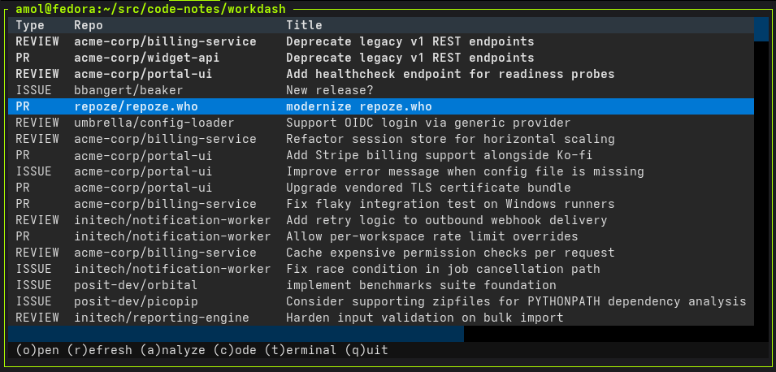

# workdash

Text-based GitHub work triage dashboard ( <https://alessandro.molina.fyi/workdash/> )

`workdash` pulls together the issues and pull requests that matter to you across
your GitHub repositories, suggests what to pick up next, and makes it easy to
jump into a work item — either for a quick review, a deeper AI-assisted
analysis, or a full coding session in a dedicated worktree.



## Platform

Linux and macOS. `workdash` uses a configured viewer and expects `zellij`
for the interactive dashboard and terminal-backed work actions. It has not
been tested on Windows.

## Requirements

- Python `>=3.12`.
- Authenticated [`gh`](https://cli.github.com/) for GitHub access.
  `workdash --configure` installs a local copy when `gh` is not available.
- An executable viewer command for opening links and rendered analyses (for example
  `xdg-open`, `open`, a terminal viewer, or a clipboard wrapper).
- `zellij` for the interactive dashboard, terminal panes, and agent sessions.
  `workdash --configure` installs a local copy when `zellij` is not available.
- Global `gh` and `zellij` binaries are preferred; configured local copies are
  used as fallbacks.
- At least one agent command-line tool (for example `claude`, `codex`, or `pi`;
  see *Agents* below) to analyze items or launch coding sessions.
- Optional: `code` — to launch a VSCode + Copilot coding session.

## Installation

With [`uv`](https://docs.astral.sh/uv/) — one isolated install, `workdash` on
your `PATH`:

```bash
uv tool install workdash
```

For development install:

```bash
pip install -e '.[test]'
```

## First-time setup

On the first run you need a configuration file at
`~/.config/workdash/config.json`. Generate it interactively with:

```bash
workdash --configure
```

The wizard fills in:

- Your GitHub username.
- Zellij availability. If `zellij` is not on `PATH`, the wizard downloads the
  latest release binary into the workdash configuration directory.
- GitHub CLI availability. If `gh` is not on `PATH`, the wizard downloads the
  latest release binary into the workdash configuration directory. Authentication
  is still handled by `gh`; run `gh auth login` if startup reports that `gh` is
  not authenticated.
- The list of repositories to track (see *Repository selectors* below).
- The todo repository where captured todos are created (defaults to
  `<username>/todos`, see *Todos* below).
- A working directory where per-item git worktrees will live.
- The agents (see *Agents* below): `claude`, `codex`, and `pi` are added with
  their default commands when they are on your `PATH`, and you can add more.

### URL and analysis viewer

The same viewer opens selected issue/PR URLs (`o`) and rendered analysis HTML
(fresh or cached). Configure it with `workdash --configure`, or edit
`~/.config/workdash/config.json` for advanced commands:

```json
{
  "open": "term-copy --quiet",
  "open_needs_pane": false
}
```

`open` remains a command string. Quoted arguments are supported; Workdash appends
one literal URL or HTML file path as the final argument. There are no templates,
shell expansion, or implicit shell commands. Explicit executable paths are allowed;
quote paths containing spaces. A missing `open` command prevents startup and tells
you to run `--configure`; there is no runtime default.

The wizard repairs missing, malformed, or unavailable viewer commands, checking
that the first command token identifies an executable on PATH or at an explicit
path. It suggests only an available `xdg-open` on Linux or `open` on macOS;
Enter accepts the displayed suggestion. With no suggestion, empty input is rejected.
Valid existing commands and unrelated settings are preserved.

For a missing or invalid `open_needs_pane`, the wizard asks
`Does the viewer require its own terminal window? [y/N]` (Enter means No).
Explicit boolean choices are preserved. Legacy configurations without this flag
continue to open directly. Direct viewers do not require Zellij and must finish
within four seconds. Set the flag to `true` for a terminal viewer: Workdash launches
it fullscreen in the current/selected active Zellij session, without creating a
session or worktree. Launch/fullscreen failures report the configured command;
viewer child errors stay visible in the pane.

Re-running `--configure` otherwise only prompts for empty fields, except for
Zellij and GitHub CLI: the wizard always checks for global binaries first and
downloads fresh local copies when none are available.

### Agents

An agent is a command-line tool that analyzes items, codes on them, or both. The
`agents` map in `config.json` gives each agent a name you choose, an `analyze`
command, a `launch` command, or both:

```json
"agents": {
  "pi": {"analyze": "pi --no-session --tools read,grep,find,ls -p", "launch": "pi"},
  "aider": {"analyze": "aider --yes"}
}
```

The order in the file is the order of the TUI dialogs, and the first agent is
the default for `workdash analyze` and `workdash code` without `--agent`. The
names `cached` and `vscode` are reserved. Workdash appends the task prompt to
the command as its last argument and runs it through your `$SHELL`, so aliases
work too. At least one agent is required.

The wizard asks about agents only when none is configured: it adds `claude`,
`codex`, and `pi` when found on your `PATH`, then asks for more analyze and
launch commands, each with a name. The TUI numbers its entries with single
keys, so the wizard accepts at most 9 analysis agents and 8 coding agents
(VSCode Copilot takes the last number in the code dialog).

## Usage

Launch the TUI:

```bash
workdash
```

Useful commands and flags:

```bash
workdash --server            # start the TUI plus localhost JSON control API
workdash --server --listen 192.168.1.5@192.168.1.10,192.168.1.11
workdash list --host dashboard.lan --json  # connect to an explicit server host
workdash list                # list server-backed dashboard items as plain text
workdash list --refresh      # ask the server to refresh items before listing
workdash list --json         # list items as machine-readable JSON
workdash info [--all] [--json]  # report live Workdash-owned Zellij panes
workdash ready SCOPE [--json]   # list the GitHub work ready to be picked up next
workdash analyze ITEM [--agent NAME] [--json]  # analyze an item
workdash code ITEM [--agent NAME] [--group NAME] [--json]  # launch an autonomous coding agent, or report the running one
workdash terminal ITEM [--json]            # open a plain terminal in an item's worktree
workdash todo TEXT [--target REPOSITORY] [--body BODY] [--json]  # capture a todo
workdash read PANE_ID [--full] [--json]  # read text from a live pane
workdash write PANE_ID TEXT [--raw] [--json]  # send text to a live pane
workdash show-config [--json] # show configured agents and selected server address
workdash --debug             # verbose logging
workdash --configure         # run the interactive setup wizard
workdash --direct            # start without the automatic Zellij wrapper
workdash --version           # print version and exit
```

## What gets shown

`workdash` gathers the following for your configured GitHub username:

- Open pull requests you authored (shown as `PR`).
- Open pull requests where you are a requested reviewer, plus open pull
  requests you have already reviewed (shown as `REVIEW`).
- Open issues assigned to you (shown as `ISSUE`).
- Open issues and pull requests across the tracked repositories. A pull request
  that is neither yours nor yours to review is shown as `CHECK`; once you review
  it, the next refresh lists it as `REVIEW`.

Items are merged, deduplicated, and sorted by last update. A pull request that
closes an issue replaces that issue, so the same work never takes two rows. One
item is marked with `*` as the suggested next thing to pick up.

### Repository selectors

The `repositories` list in `config.json` accepts:

- `owner/repo` — a specific repository.
- `owner/*` — every repository accessible to you under that owner.

## TUI keybindings

- `/` — search/filter the listed items by Type, Repo, or Title. Press `/` again
  to clear.
- `o` — open the selected item with your configured viewer.
- `r` — refresh the list from GitHub.
- `a` — analyze the selected item. Opens a dialog to open the cached analysis
  (if any), or run a fresh analysis with any configured analysis agent. Fresh
  analyses are cached and rendered as HTML with your configured viewer.
- `c` — launch a coding session on the selected item. Opens a dialog to pick
  one of your configured coding agents or VSCode Copilot. `workdash` prepares a
  dedicated git worktree for the item and starts the chosen tool in it, preloaded
  with context about the issue or PR. If an agent is already running in the
  item's worktree, `c` focuses its pane instead of opening the dialog.
- `t` — open a terminal in the selected item's worktree (no agent launched).
- `w` — capture a todo. Opens a dialog asking for the todo text and an
  optional target repository.
- `q` — quit.

## Todos

Ideas and chores that show up while triaging can be captured as todos with `w`
in the TUI, `workdash todo TEXT`, or the JSON API. A todo is an ordinary GitHub
issue created in the single `todo_repository` from `config.json`, assigned to
you and labeled `workdash-todo`, so it shows up on the dashboard like any other
assigned issue. Create the repository on GitHub yourself; the label is created
on first use.

For long details, keep the title short and pass `--body`:

```bash
workdash todo "Plan the migration" --body "Research findings and next steps..."
```

`POST /api/v0/todo` likewise accepts an optional `body` string alongside `text`
and `target`. The issue body starts with Workdash's metadata block; user content
is appended after it without changing formatting. Omitting the body keeps the
existing metadata-only output. The TUI continues to capture title-only todos.

A todo may name a GitHub target (`--target owner/repo`) or a git URL on any
hosting service (`--target https://codeberg.org/owner/repo.git`). HTTPS (with or
without `.git`), `ssh://`, `git://`, and scp-like `git@host:owner/repo.git` URLs
are supported. URL targets are cloned with Git automatically; no manual clone
or worktree preparation is needed. The issue still
lives in the todo repository, but the item is listed under its target and its
coding, terminal, and analysis actions run in a worktree of the target checked
out on a `wt-<number>` branch. URL targets display as their final `owner/repo`
path segments, while metadata keeps the original URL. Targets with the same
`owner/repo` on different hosts can have the same item ID; conflicting local
directories are reported rather than reused.

## Worktrees

Coding and analysis actions operate on a per-item git worktree rooted under the
configured `workdir`. Each tracked repository gets a local clone, and each work
item gets its own worktree alongside it, so you can hop between items without
disturbing other in-progress work.

A pull request you authored that closes an issue in the same repository is the
implementation of that issue, so it shares the issue's worktree directory (named
after the issue number) while staying checked out on the pull request's own
branch. That shared checkout is only reused while it holds the pull request's
branch; a checkout sitting on another branch belongs to other work, so it is left
alone and the pull request gets its own pull-request-numbered worktree instead.
Worktree directories created before this behavior existed are still named
after the pull request number; they are not migrated and keep working, so the
pull request stays in the checkout it already has and only a pull request with no
checkout yet gets an issue-numbered one. The link between a pull request and the
issue it closes is resolved while the dashboard refreshes, so a pull request
added by URL only shares the issue's worktree from the next refresh onwards.

## Local control server

`workdash --server` starts the normal TUI and a JSON control API in the same
process. It listens on `WORKDASH_HOST` (default `127.0.0.1:8765`), accepts JSON only, and stops all
listeners when the TUI exits.

For trusted LAN access, add repeatable `--listen HOST@IP1,IP2` options alongside
`--server`. Each listener needs a nonempty list of exact accepted source IPs
(no hostnames or subnets). All supplied source IPs are shared across every
listener, with localhost and the primary server IP always accepted.
Access checks use the actual peer IP, never forwarding headers. Wildcard binds are
rejected; extra listeners use the selected server port.
If any listener cannot bind, the entire server startup fails.

**Trusted LAN only:** the API is intentionally unauthenticated plain HTTP.
Allowed clients can execute dashboard actions; do not expose it to untrusted
networks or treat the IP allowlist as authentication or encryption.

Client commands `list`, `info`, `ready`, `analyze`, `code`, `terminal`, `todo`, `read`,
`write`, and `close` accept `--host HOST[:PORT]` before or after the command.
Set `WORKDASH_HOST` to an IPv4 address or IPv4 address:port to select the default
for both server and clients; omitted ports use 8765. An explicit `--host` replaces
that default, even if `WORKDASH_HOST` is invalid.
A server dashboard already inside Zellij uses its current session, regardless
of its name.
Extra listener hosts and explicit client `--host` values may be IP addresses or DNS hostnames. Clients connect
to the selected server without loading local GitHub, configuration, or Zellij state. Todo's `--target`
still selects its repository, independently of the server host. `show-config`
reports the selected default server address.

## List command

`workdash list` requires a running `workdash --server` session and emits one row
per server-known item, sorted by last update (most recent first):

```
TYPE   repo#TYPE-N   YYYY-MM-DD   title
```

`TYPE` is `ISSUE`, `PR` (a PR you authored), `REVIEW` (for review-requested or
already reviewed PRs), or `CHECK` (any other PR). The row ID is
copy/paste-friendly: `repo#ISSUE-N`, `repo#PR-N`, `repo#REVIEW-N`,
`repo#CHECK-N`, or `<target>#ISSUE-WT<n>` for a targeted todo. The suggested
item's title is prefixed with `* `. If nothing matches, the output is
`No work items found.`.

Use `workdash list --refresh` to ask the server to refresh GitHub data before
listing. Use `workdash list --json` to emit the same list as JSON records with
item ID, type, kind, repository, number, title, URL, timestamps, and suggested
status.

## Ready command

`workdash ready SCOPE [--json]` requires a running `workdash --server` session
and lists the GitHub work that can be picked up next, read straight from GitHub
rather than from the dashboard. It only reports: nothing is claimed or launched.

`SCOPE` is one of:

- `owner/repo`: every open issue and pull request of the repository, plus the
  open pull requests closing its issues.
- An issue (`owner/repo#42`, `owner/repo#ISSUE-42`, a targeted todo ID, or an
  issue URL): its native sub-issues, recursively and across repositories, or the
  issue itself when it never had sub-issues. Only pull requests closing one of
  those issues count.
- `todo`: the server's todo repository.
- `any`: every repository selected by the server's `repositories`, plus the todo
  repository.

A pull request is ready when the server can push to its head branch and its
current head needs work: `address_review` (a changes-requested review on the
current head, or review bodies, unresolved threads, and comments that other
humans posted after the last push), `fix_merge_conflicts` (GitHub reports a
conflict with the current base branch), or `fix_ci` (a check or status on the
current head failed). An issue is ready when it is open, never had sub-issues,
has no open `blocked by` issue, and no open pull request closes it. Work a live
Workdash code pane holds is left out, and so are pull requests that only wait
for CI, review, or merge.

Ready pull requests come first, then ready issues, each group oldest first:

```
TYPE  ID                           ACTION               title URL [REASONS] (issue ID)
```

Each ID is accepted as is by `code`, `analyze`, and `terminal`; a ready pull
request names the issue it closes. `--json` adds the head SHA, base branch and
its head SHA, mergeability, CI status (`passing`, `failing`, `pending`,
`no_checks`, or `unknown`), failing checks, and feedback references. CI status
comes from GitHub check metadata and the base branch's required checks only,
never from repository files. If nothing is ready the output is
`No ready work found.`.

## Info command

`workdash info [--json]` requires a running `workdash --server` session and
reports live Workdash-owned Zellij panes for terminal-backed work actions,
including pane title, cwd, command, tab, state, and mapped Workdash item. It maps
each live pane's current working directory to the matching Workdash item ID when
the pane is inside a known worktree, or reports `unknown` when no mapping is
known. Add `--all` to include other live non-plugin panes from the server-backed
Workdash session as `kind=unknown` with unknown item mapping.

## Analyze command

`workdash analyze ITEM [--agent NAME] [--json]` requires a running
`workdash --server` session and analyzes a work item. `ITEM` can be a row ID from
`workdash list` (such as `owner/repo#ISSUE-123`), `owner/repo#123` for an issue,
or a GitHub issue/PR URL. The item does not need to be on the dashboard: the
server looks up any issue or pull request it can access on GitHub, without adding
it to `workdash list` or to the included items. `workdash terminal` accepts the
same items. It reuses a
fresh cached analysis when available, otherwise the server prepares the item's
worktree and runs the selected configured analysis agent.

The server analyze response includes `content_type` (`text/markdown`), `file_name`,
and base64 `file_content` so clients do not need filesystem access to the server
cache. The CLI writes that content to a secure temporary local file and reports it
as `analysis_path`. `--json` emits the same client-side result without the raw
base64 content.

## Code command

`workdash code ITEM [--agent NAME] [--group NAME] [--json]` requires a running
`workdash --server` session and launches a configured coding agent for a work
item. `ITEM` accepts the same items as `workdash analyze`. With `--group NAME`,
the server opens a new agent pane in the named Zellij tab, creating it if needed;
without it the pane opens in the current tab. This also works with `--host`.
An existing agent remains in its current tab regardless of the requested group.
The API accepts the same option as a `group` string.

At most one coding agent works in a worktree: its live `code_` Zellij pane is the
claim, with no claim command or stored claim state. When an agent pane launched
for the item's worktree is still live, including one started for another item
sharing that worktree, wherever its cwd has moved, `code` starts nothing and reports `status` `already_running` with that
pane. Otherwise it reports `launched` once the new pane is visible. If Zellij
cannot list its panes, or a launched pane does not show up, `code` starts nothing
and reports an error; a retry within a minute of an unconfirmed launch fails too.
An agent that exits right after launch is reported as an error and does not block
a retry.
Terminal panes do not count. VSCode Copilot, offered only by the TUI, holds no
claim and is not opened while an agent pane is live. In the TUI, `c` on an item
with a live agent pane focuses that pane instead of opening the dialog.

`workdash code` always autostarts the agent: its briefing ends with an appendix
telling it to work without routine confirmation, commit, push, and open a pull
request that closes the issue (or update the existing one), and verify the
pull request's current head: CI `passing`, or GitHub reporting no required or
observed checks (`no_checks`), and a clean merge. It never merges or closes
anything, and the agent stays in its interactive pane. The state-specific task
comes from the same GitHub classification as `ready`: an issue is implemented, an
issue an open pull request of yours closes resumes that pull request in place, and a pull
request with review feedback, merge conflicts, or failing CI is repaired on its
own branch with every reason included. A pull request waiting on CI, review, or
merge is described, not reworked, and somebody else's pull request stays a
review-only session. There is no `--autostart` option; the TUI's `c` keeps the
plan-first briefing and never commits or pushes by itself, and the HTTP
`POST /api/v0/code` takes an optional boolean `autostart`, false when omitted.
`already_running` injects nothing into the running agent.

Human output reports the status, item, agent, selected session, actual tab, cwd,
pane title, and pane id when available. `--json` emits the same result as machine-readable JSON.

## Read and write commands

`workdash read PANE_ID [--full] [--json]` requires a running `workdash --server`
session and reads pane text through the server-backed pane content API. Human
output prints the pane text directly. Add `--full` to request full scrollback.

`workdash write PANE_ID TEXT [--raw] [--json]` requires a running
`workdash --server` session and sends pane input through the server-backed pane
send API. By default Workdash appends Enter; `--raw` or `--no-enter` sends the
text exactly. Human output confirms that the pane accepted the input.

## Show-config command

`workdash show-config [--json]` reports configured analysis agents, configured
coding agents, and the selected server address. It does not require a running
server. The same information is also available from the JSON API for HTTP
clients.

## Analysis cache

Analyses produced with `a` or `workdash analyze` are cached under
`~/.config/workdash/cache/` so that re-opening an item is instant. The cache is
keyed by the item's GitHub
`updated_at` timestamp, so any change on GitHub automatically invalidates the
cached analysis and the next analyze action will re-run it.

## Product behavior

Canonical product behavior is described in [`features/`](features/).

The `.feature` files are the source of truth for what the software does. They are product specifications first and executable BDD scenarios second.

Implementation progress can be tracked separately.
BDD is the integration point between humans and agents collaborating on the project as Workdash relied hevily on agents during its initial development cycle.

### BDD-first development (mandatory)

Every new feature **must** start with a BDD definition under [`features/`](features/), and every change to existing behavior **must** update the relevant `.feature` file **before** any implementation or test code is modified. The `.feature` files are the contract; code follows them, not the other way around.

This applies to agents and humans alike. A change that lands code without a matching `features/` update is incomplete.

## Tests

From the repository root:

```bash
PYTHONPATH=src pytest
```

### BDD suite

`tests/bdd/` drives development from the `.feature` files in `features/`.
`pytest_bdd.scenarios(...)` auto-generates one pytest test per `Scenario`,
so adding a scenario to `features/` is enough to pull it into the suite.
Step definitions live under `tests/bdd/steps/`; scenarios whose steps are
not yet implemented fail with `StepDefinitionNotFoundError`, which is the
intended TDD signal for BDD-first development.

## License

`workdash` is distributed under the terms of the GNU General Public License
version 3. See [LICENSE](LICENSE) for the full text.
